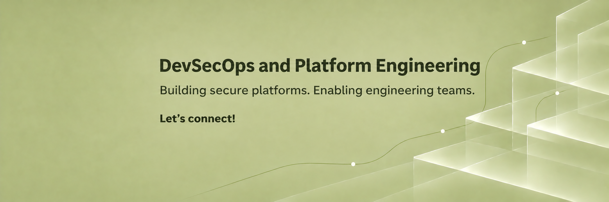

<!--
Some ideas to get started:

- 🔭 I’m currently working on ...
- 🌱 I’m currently learning ...
- 👯 I’m looking to collaborate on ...
- 🤔 I’m looking for help with ...
- 💬 Ask me about ...
- 📫 How to reach me: ...
- 😄 Pronouns: ...
- ⚡ Fun fact: ...

Sections to be added:
- Banner
- About me
- Selected projects
- Skills
- Work with me
- Speaking
- Stats

-->
### About me
I am a <strong>DevSecOps/Platform Engineering leader</strong> strongly focused on building secure, scalable and reliable Internal Development Platforms. I combine hands-on expertise in Kubernetes, cloud infrastructure, AI-assisted development and security with technical leadership and mentoring competences. I focus on making software delivery simpler, and security part of everyday engineering. I concentrate on connecting technical decisions to the needs of developers and wider business. 

As a leader, I set clear direction and enable engineers to build great products.

### Let's connect!

  
   
  

